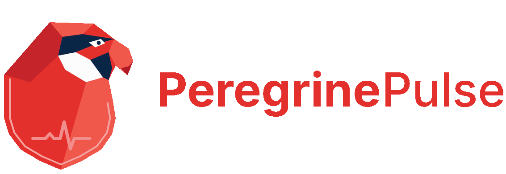

# PeregrinePulse — Project Plan

> **Autonomous Human-Centered Rescue Intelligence** · Team **FalcoPeregrinus**
>
> Version **0.2** (concept-based plan) · Last updated 2026-11-21 · Status: **Draft for owner review** · Language: English only
>
> This is the primary execution reference. It describes a **simulated, prototype** rescue-coordination system.
> It is **not** a certified emergency dispatch system and makes no claim of integration with official emergency services.

---

## 0. How to Read This Plan

The plan is organised the way large engineering projects organise theirs: by **concepts** (self-contained subsystems with a purpose, design direction, guardrails and a task register), plus a small set of **cross-cutting views** (milestones, dependencies, team, testing, automation, risks).

| Section | What it answers |
|---|---|
| 1 Charter | What and why: vision, users, goals, scope |
| 2 Requirements | Functional and non-functional requirements |
| 3 Architecture Direction | System shape, repository layout, technology decisions |
| 4 Concepts (C01–C17) | The work itself, concept by concept, with task registers |
| 5 Milestones | Measurable checkpoints and exit gates |
| 6 Dependencies | Critical path, parallel work, integration risks |
| 7 Team Distribution | Deferred by the owner; not defined in this version |
| 8–9 Testing, Definition of Done | How work is verified and when it counts as finished |
| 10 Automation | Task-tracking contract and GitHub Actions design |
| 11–12 Risks, Assumptions, Open Items, Decision Log | What could go wrong and what is still undecided |
| 13 Beyond the MVP | Future work (not tracked in progress) |
| Appendices | Commit convention, PR template, brand assets |

**One file, no split.** All tasks and their status live here. Progress and milestone views in `README.md` are generated from this file (Section 10).

**Honesty rule used everywhere.** A feature is `done` only when it is implemented, tested and documented. Anything simulated is labelled *SIMULATED*. No performance number is stated until an experiment has produced it.

---

## 1. Project Charter

### 1.1 Overview
PeregrinePulse coordinates emergency assistance from the first danger signal until a **trusted acknowledgment** is received. It is a closed loop: **Observe → Interpret → Assess → Plan → Act → Verify → Adapt.** Unlike a one-button SOS, it weighs risk and confidence, the person's ability to communicate, the assistance needed, entity capability and safety, and the state of each communication path — and it never treats "sent" as "handled".

### 1.2 Vision
No one's chance of receiving help should depend on their ability to open a phone, speak, or understand technical steps in a frightening moment. The long-term vision is a rescue-coordination platform that continues to work **when connectivity is absent** (Wi-Fi → mobile network → satellite), adapts to the person, routes to verified entities, and reports only what it can prove.

### 1.3 Target Users
| User | Need |
|---|---|
| Person who cannot request help (injured, unresponsive, frightened, deaf/non-speaking, mobility-impaired) | Help request that does not depend on speech or fine motion |
| Child (later, after specialist review) | Simple, safe, non-burdensome interaction |
| Registered personal contacts | Timely, minimal, consented notification |
| Assistance entities (specialist responders, community assistance points) | Structured, prioritised, verifiable alerts |
| Operators and judges using the dashboard | Clear view of state, reasons and evidence |
| Team members | Reproducible experiments and an auditable decision trail |

### 1.4 Goals
Success is measured by experiments run on documented scenarios; numeric targets are set only after the baseline is measured.

| ID | Goal |
|---|---|
| G1 | Reduce time to the first useful information reaching an entity, versus a static SOS baseline |
| G2 | Increase the share of requests that receive a trusted human acknowledgment |
| G3 | Measure recovery time after the first selected entity fails to acknowledge |
| G4 | Deliver Tier-1 critical information under weak and absent connectivity (satellite path simulated) |
| G5 | **Offline honesty:** zero cases of "Delivered" or "Acknowledged" shown without evidence in the failure-matrix tests |
| G6 | Measure adaptation to the person's ability to respond |
| G7 | Measure detection quality: precision, recall, false-positive and false-negative rates on a defined test set |
| G8 | Run the system deployed on Huawei Cloud (ECS + RDS) |
| G9 | Make every experiment reproducible: fixed seed, fixed configuration, one command |
| G10 | *(Optional, unconfirmed)* Let the rescue agent contact designated entities **directly** when a problem is detected, against clearly labelled test endpoints |

### 1.5 Scope
**In scope (initial release / MVP)**
- Android application (thin native) with a platform-independent core, plus a web dashboard and a cloud platform service.
- One locked MVP scenario (provisional: **vehicle collision with an unresponsive driver**, see RSK-01).
- Simulated incidents, a test registry of clearly labelled test entities, simulated notification of registered contacts.
- Connectivity ladder (Wi-Fi → mobile network → satellite) with offline queue and retry; the **satellite link is a rented third-party service in production and simulated in the initial experiments**.
- Evidence-based lifecycle, escalation, decision trace, baseline comparison and reproducible experiments.
- Deployment on Huawei Cloud (ECS + RDS).
- Interface languages: English, Arabic, Chinese.

**Explicitly out of scope**
- SIM/eSIM, wallet, advertising, rewards, pricing or any telecom-service business model.
- Claims of official integration with emergency services; replacing the national emergency number.
- Medical diagnosis, medication or dosage advice.
- Always-on camera or microphone monitoring.
- Building or operating our own satellite or ground station.

**Later releases:** see Section 13.

### 1.6 Guiding Principles
1. **Evidence over assumption** — lifecycle stages require evidence.
2. **Model proposes, policy decides** — any AI suggestion passes a deterministic policy gate.
3. **Say what is simulated** — visible labels in app, dashboard, docs and results.
4. **Minimum data, clear consent** — collect only what rescue needs.
5. **Prove the core loop first** — add optional technologies only after it works.
6. **Honest failure** — "not delivered yet" is a valid, displayed state.

---

## 2. Requirements

### 2.1 Functional Requirements
| ID | Requirement | Concepts |
|---|---|---|
| FR-01 | Receive or replay emergency signals and create an incident | C02, C09 |
| FR-02 | Assess risk with confidence, uncertainty and an explanation | C02 |
| FR-03 | Ask the user to verify or cancel; silence is never treated as confirmation by itself | C02, C08 |
| FR-04 | Estimate capability (fully / partially / unable / unknown) and adapt interaction | C03 |
| FR-05 | Select entities from a registry using hard exclusion rules and documented criteria | C04 |
| FR-06 | Notify the user's registered contacts (simulated in the MVP) | C04 |
| FR-07 | Send a tiered alert (Tier 1 critical first) through the connectivity ladder | C06 |
| FR-08 | Queue offline, retry, de-duplicate and survive restarts | C06 |
| FR-09 | Accept satellite-path messages through a gateway (simulated provider) | C07 |
| FR-10 | Track acknowledgment and escalate when none arrives; evidence-backed lifecycle | C01, C05 |
| FR-11 | Record a decision trace and audit log for every major decision | C05 |
| FR-12 | Dashboard: simulation, risk, selection, acknowledgment/escalation, timeline | C10 |
| FR-13 | Manual SOS independent of automatic detection | C08 |
| FR-14 | Multilingual UI (English, Arabic, Chinese) with RTL support | C16 |
| FR-15 | Static-SOS baseline and reproducible experiments | C14 |
| FR-16 | Cloud deployment with repeatable scripts | C11 |
| FR-17 | *(Optional)* Direct agent contact with designated entities | C17 |
| FR-18 | *(Optional)* ESP32 emulation of a satellite module | C07 |

### 2.2 Non-Functional Requirements
| ID | Requirement |
|---|---|
| NFR-01 | **Evidence integrity:** no lifecycle stage without its required evidence type |
| NFR-02 | **Reproducibility:** seeds, configs, recorded outputs, single run command |
| NFR-03 | **Privacy:** data minimisation, consent, retention policy; synthetic data only in the public repository |
| NFR-04 | **Security:** encrypted transport, authentication, replay protection, secrets kept out of source |
| NFR-05 | **Reliability:** persist-first ingestion, crash recovery, idempotent re-delivery, no duplicate alerts |
| NFR-06 | **Explainability:** reasons recorded for classification, selection, refusal and escalation |
| NFR-07 | **Accessibility:** more than one interaction mode; large targets; screen-reader labels |
| NFR-08 | **Maintainability:** versioned contracts, tests, CI on every pull request |
| NFR-09 | **Portability:** the mobile core has no Android dependency |
| NFR-10 | **Transparency:** simulated versus real always visible |
| NFR-11 | **Performance:** no promised numbers; targets are set after baseline measurement |
| NFR-12 | **Energy:** battery impact measured on target devices, not assumed |

---

## 3. Architecture Direction

### 3.1 System View
```
 Phone (mobile/)                                        Cloud (platform/ on Huawei Cloud)
 ┌──────────────────────────┐   Wi-Fi / mobile network  ┌─────────────────────────────────────┐
 │ :android  sensors, UI,   │ ────────────────────────► │ API  → Orchestrator → Registry      │
 │           transports     │                           │        (policy, planner, tools)     │
 │ :core     risk rules,    │   satellite (rented       │ Satellite Gateway (provider adapter)│◄── provider ground segment
 │           capability,    │   service; SIMULATED)     │ Notification service (SIMULATED)    │       (or Simulated Satellite Link)
 │           ladder, queue  │ ────────────────────────► │ RDS: incidents, trace, registry     │
 └──────────────────────────┘                           └───────────────┬─────────────────────┘
        ▲ optional: BLE/USB ◄── hardware/ (ESP32 module emulator)       │ feed
                                                                        ▼
                                                              Dashboard (platform/dashboard)
```

### 3.2 Repository Layout (single repository)
```
PeregrinePulse/
├── mobile/            Android app: :core (platform-independent Kotlin) and :android
├── platform/
│   ├── server/        API, orchestrator, registry, satellite gateway, notification service
│   └── dashboard/     Web dashboard
├── hardware/          ESP32 satellite-module emulator (optional)
├── contracts/         Shared schemas: incident, payload tiers, states, acknowledgments, decision trace
├── experiments/       Baselines, scenarios, configs, results
├── data/              Synthetic data and dataset documentation
├── cloud/             Deployment scripts and environment notes
├── dev-assistants/    Tool-agnostic AI development assistant skills and workflows
├── docs/              Architecture, API, methodology, ADRs, contributing
├── scripts/           Tracking parser and status generators
├── assets/            Brand assets; generated status graphics in assets/status/
├── .github/           Workflows and pull-request template
├── README.md  PROJECT_PLAN.md  setup.md  LICENSE  .gitignore  .editorconfig  .env.example
```
Work branches are prefixed by area: `mobile/…`, `platform/…`, `hardware/…`, `docs/…`. CI runs only the checks relevant to the changed paths.

### 3.3 Technology Decisions
| Area | Choice | Status | Rationale / note |
|---|---|---|---|
| Mobile | Android native (Kotlin), **thin app** + `:core` module | Approved | Value lies in reliable background behaviour; core isolated for tests and later iOS reuse |
| Mobile targets | Android with Google services (FCM) and Huawei Android-based devices (HMS), via an abstraction layer | Approved | HarmonyOS NEXT native and iOS are future |
| Backend | Python, FastAPI | Proposed | From the technical specification |
| Decision engine | Deterministic rules + state machine, optional model proposals behind a policy gate | Proposed | Auditable, testable |
| Dashboard | React | Proposed | From the technical specification |
| Database | Huawei Cloud RDS for MySQL (source of truth) | Proposed | Structured, persistent incident history |
| Hosting | Huawei Cloud ECS | Proposed | Requirement of the deployment |
| Cache | Huawei Cloud DCS for Redis | Optional | Only if workload justifies it |
| Satellite path | Rented third-party service (provider TBD); simulated initially | Approved | No own satellite or ground station |
| Satellite module emulator | ESP32 over BLE/USB | Approved (optional milestone) | Language TBD |
| Tests | JUnit (mobile core), pytest (platform), component/e2e smoke (dashboard) | Proposed | |
| AI dev assistants | Tool-agnostic; one or more | Approved | See C12 |
| Languages (UI) | English, Arabic, Chinese | Approved | Documentation is English only |
| License | All rights reserved, with an evaluation-view notice | Approved | See OPS-10 |

---

## 4. Concepts

**Task register conventions** (parsed by automation, see Section 10):
`Pri` P0 = MVP, P1 = Essential, P2 = Optional/Secondary · `MS` = milestone (M0–M8) · `Status` ∈ `todo`, `doing`, `blocked`, `done`. Effort is **not estimated** (not enough information yet).

| Concept | Name | Prefix |
|---|---|---|
| C01 | Incident Lifecycle & Contracts | LIF |
| C02 | Detection & Risk Assessment | RSK |
| C03 | Human Capability & Interaction | HCA |
| C04 | Registry & Contacts | REG |
| C05 | Rescue Orchestrator | ORC |
| C06 | Connectivity Ladder & Offline Delivery | NET |
| C07 | Satellite Path | SAT |
| C08 | Mobile App | MOB |
| C09 | Platform API & Data | API |
| C10 | Responder Dashboard | DSH |
| C11 | Cloud Deployment | CLD |
| C12 | AI Development Assistants | DEV |
| C13 | Security, Privacy & Safety | SEC |
| C14 | Evaluation & Experiments | EVL |
| C15 | Repository, Automation & Docs | OPS |
| C16 | Localization & Accessibility | LOC |
| C17 | Direct Entity Contact *(optional, unconfirmed)* | DEC |

### C01 — Incident Lifecycle & Contracts (LIF)

**Purpose.** One shared language between phone, platform, dashboard and experiments: the incident object, payload tiers, state model and evidence rules. Everything else depends on it.

**Design direction**
- **Two-layer state model.** Internal states drive the server and agent; **seven user-facing stages** are shown to people, plus overlay flags. A mapping table is the single source of truth.
- **Evidence rule.** A stage may only be shown when its evidence type exists. A relay or gateway receipt is never presented as an entity acknowledgment.
- **Contracts are versioned** and live in `contracts/`; changes need review from every team member.

**Internal states → user-facing stages (initial proposal)**

| Internal state(s) | User-facing stage | Required evidence |
|---|---|---|
| CREATED, VALIDATING, ASSESSING, AWAITING_USER, PLANNING, AUTHORIZED | Prepared | none (local) |
| SENDING | Sent | `handoff` (a transport accepted the message) |
| AWAITING_ACK (after delivery) | Delivered | `endpoint_delivered` |
| ACKNOWLEDGED | Acknowledged | `human_acknowledged` from a verified entity |
| DISPATCH_CONFIRMED | Response Dispatched | `response_dispatched` |
| ARRIVAL_CONFIRMED | Arrived | `arrival_confirmed` |
| CLOSED | Closed | closure criterion met and recorded |
| QUEUED_OFFLINE, RETRY_WAIT | overlay: **Queued** | — |
| CANCELLED | overlay: **Cancelled** | user or policy cancellation recorded |
| ESCALATING | overlay: **Escalating** | no-ack timeout recorded |
| EXHAUSTED, REJECTED_BY_POLICY | overlay: **Not handled** | attempts exhausted or policy refusal recorded |

`service_received` (a service or gateway accepted the message) is recorded but displays as *Sent*, never *Delivered*.

**Task register**

| ID | Task | Pri | MS | Depends | Done when (deliverable · acceptance · tests) | Status |
|---|---|---|---|---|---|---|
| LIF-01 | Canonical Incident Object schema v0.1 | P0 | M0 | — | JSON Schema in `contracts/incident` (id, detection time, probable event type, confidence, per-field source, location with accuracy and measured time, user state, needs/hazards, attempts log) · valid and invalid fixtures pass validation tests | todo |
| LIF-02 | Tiered payload specification (Tier 1/2/3) | P0 | M0 | LIF-01 | Tier 1 compact encoding defined with mandatory fields (distress, location+age+accuracy, probable event type, detection time, incident id); Tier 2/3 optional · round-trip encode/decode tests | todo |
| LIF-03 | Two-layer state model and mapping table | P0 | M0 | LIF-01 | Machine-readable transitions in `contracts/states` and diagram in `docs/architecture` · tests cover every legal and illegal transition | todo |
| LIF-04 | Evidence model and display rule | P0 | M0 | LIF-03 | Evidence types and stage-to-evidence table · property tests prove no stage is reachable without its evidence | todo |
| LIF-05 | Contract versioning and compatibility policy | P1 | M0 | LIF-01 | Semantic versioning and changelog rules in `docs/` · contract tests run mobile and platform fixtures against the same version | todo |
| LIF-06 | Decision Trace schema | P0 | M0 | LIF-01 | Fields: input context, timestamp, policy version, selected action, explanation, entity selected, acknowledgment status, escalation history · schema tests | todo |
| LIF-07 | Idempotency and de-duplication rules | P0 | M0 | LIF-01 | Rule on incident id + sequence documented · duplicate, late and out-of-order fixtures resolve to one incident state | todo |

---

### C02 — Detection & Risk Assessment (RSK)

**Purpose.** Turn raw or replayed signals into a calibrated, explainable assessment: probable event, risk, confidence, uncertainty, recommended action.

**Design direction**
- Start with an **interpretable rule baseline** over a time window before and after the event; no single reading triggers an alert.
- Features: impact magnitude, duration, direction change, post-event immobility, speed-to-stop transition, activity context.
- Situation levels: *Signal Unusual → Emergency Possible → User-Confirmed → High-Confidence Unresponsive → Cancelled/False Alarm*. Silence is evidence to weigh, not proof.
- Output never states a medical condition. A learned model is considered only if a suitable dataset and evaluation exist.

| ID | Task | Pri | MS | Depends | Done when (deliverable · acceptance · tests) | Status |
|---|---|---|---|---|---|---|
| RSK-01 | Lock the MVP scenario and scope sheet | P0 | M0 | — | Provisional scenario (vehicle collision, unresponsive driver) approved or replaced by the owner; documented inputs, expected outcomes and exclusions · decision recorded; blocks RSK-02 and EVL-01 | todo |
| RSK-02 | Windowed signal feature extraction in `:core` | P0 | M1 | RSK-01, LIF-01 | Feature set from the design direction computed on recorded/synthetic traces · unit tests on labelled traces | todo |
| RSK-03 | Rule-based risk scorer with confidence and uncertainty | P0 | M1 | RSK-02 | Outputs risk score, confidence, classification, recommended action, signals used · lookalike traces (phone drop, sport, normal hard stop) do not escalate alone | todo |
| RSK-04 | Situation levels and policy gate | P0 | M1 | RSK-03, LIF-03 | Configurable thresholds; silence never auto-confirms · transition tests incl. cancel and timeout paths | todo |
| RSK-05 | Calibration harness | P1 | M5 | RSK-03, EVL-02 | Computes precision, recall, FPR, FNR and confidence calibration on held-out traces · results saved by the experiment harness | todo |
| RSK-06 | Optional learned-model feasibility note | P2 | M8 | RSK-05, EVL-01 | Decision document: data sufficiency, labels, evaluation plan, go/no-go · reviewed by the owner | todo |

---

### C03 — Human Capability & Interaction (HCA)

**Purpose.** Estimate how able the person is to interact and adapt wording, pace and input mode accordingly — without claiming to know their medical or emotional state.

**Design direction**
- States: fully responsive, partially responsive, unable to respond, unknown — inferred from interaction signals (response, latency, input method), shown with rationale.
- Adaptation: shorter text, one question at a time, visual-only options, large targets. Adaptation never changes the facts of the alert.
- Guidance text comes only from reviewed sources with provenance; **no diagnosis, no medication, no dosage**.
- Child-specific interaction is optional and gated on specialist review.

| ID | Task | Pri | MS | Depends | Done when (deliverable · acceptance · tests) | Status |
|---|---|---|---|---|---|---|
| HCA-01 | Capability state model and inference rules | P0 | M1 | LIF-01 | Four states with recorded rationale, in `:core` · unit tests; no medical claims in outputs | todo |
| HCA-02 | Interaction adaptation rules and templates | P1 | M3 | HCA-01 | Rule table and templates per capability state · tests assert the expected template for each state | todo |
| HCA-03 | Guidance content library with provenance | P1 | M7 | HCA-01 | Safety-first generic guidance, each item with source, version, review date, approver · reviewer sign-off recorded | todo |
| HCA-04 | Child-safe interaction profile | P2 | M8 | HCA-03 | Draft profile and specialist review gate; forbidden-instruction list · no use in demos before review | todo |
| HCA-05 | Instruction safety test suite | P1 | M7 | HCA-03 | Tests reject instructions to approach hazards, move injured people, touch blood or sharp objects, or claim help has arrived without evidence | todo |

---

### C04 — Registry & Contacts (REG)

**Purpose.** Know which entities exist, what they can do, whether they are safe and available — and which personal contacts the user chose.

**Design direction**
- Registry entries record identity, verification source/date, coordinates and coverage, hours, capabilities, availability, capacity, contact method, escalation conditions, limits and `last_updated`.
- **Nominal versus current capability** are different; stale data is flagged.
- Selection uses **hard exclusion rules first** (unverified, inside the hazard zone, closed, wrong capability), then a documented suitability score whose weights come from experiments, not guesses.
- Community assistance points have limited roles and never replace the specialist entity.
- Everything in the MVP registry is a **labelled test entity**; it is not an official database.
- Personal contacts are picked individually, with clear sharing rules; no address-book upload.

| ID | Task | Pri | MS | Depends | Done when (deliverable · acceptance · tests) | Status |
|---|---|---|---|---|---|---|
| REG-01 | Registry data model | P0 | M0 | LIF-01 | Schema and migration draft covering the fields above · schema validation tests | todo |
| REG-02 | Test registry seed | P0 | M1 | REG-01 | Specialist types and community points, all flagged `is_test` · no test entity can render as real | todo |
| REG-03 | Selection engine (exclusions + suitability) | P0 | M1 | REG-02, RSK-03 | Every decision lists accept/reject reasons · tests: excluded entity is never chosen even if nearest | todo |
| REG-04 | Staleness and nominal-vs-current capability | P1 | M2 | REG-03 | TTL on availability; stale entries down-ranked or excluded · tests with aged fixtures | todo |
| REG-05 | Registered contacts: model and consent rules | P0 | M1 | LIF-01 | What is shared, when, and how to change it; individual selection only · schema and rule tests | todo |
| REG-06 | Contact notification service (simulated) | P0 | M2 | REG-05, ORC-04 | Simulated provider adapter; timeline labels the event *SIMULATED*; real channel left as an open item (O2) · integration test | todo |
| REG-07 | Registry verification and update workflow | P1 | M7 | REG-02 | Documented roles (add, verify, update, suspend, expire) and prototype admin operations · stated clearly as non-official | todo |

---

### C05 — Rescue Orchestrator (ORC)

**Purpose.** The runtime decision-maker: plan, act through approved tools, monitor evidence, adapt, and stop.

**Design direction**
- Components: **Planner**, **Policy Engine**, **Tool Executor**, **Monitor**, **Audit Log**.
- Tools have declared inputs, outputs, timeouts and idempotency keys: incident-context, registry-query, path-evaluator, send-alert, relay-request, delivery-status, retry/escalation.
- The policy engine refuses unregistered destinations, cannot change its own policy, and forbids claims without evidence. Refusals are logged with the reason.
- Retries are bounded; the agent stops on a closure criterion, exhausted attempts, cancellation, or when a human step is required.
- This runtime agent is **separate** from the AI development assistants (C12).

| ID | Task | Pri | MS | Depends | Done when (deliverable · acceptance · tests) | Status |
|---|---|---|---|---|---|---|
| ORC-01 | Tool contracts | P0 | M0 | LIF-01, LIF-04 | Schemas, timeouts and idempotency keys for each tool · contract tests with fixtures | todo |
| ORC-02 | Policy engine | P0 | M1 | ORC-01 | Permission and guard rules incl. refusal logging · tests: unregistered target, evidence-less claim, self-modification all refused | todo |
| ORC-03 | Deterministic planner | P0 | M1 | ORC-02, REG-03, NET-01 | Goal, candidate entities, order, retry windows, escalation and closure conditions; re-plans on change · scenario tests | todo |
| ORC-04 | Tool executor and monitor | P0 | M1 | ORC-03, LIF-03 | Tracks sending → receipt → acknowledgment with timeouts · state-transition tests | todo |
| ORC-05 | Escalation and retry controller | P0 | M1 | ORC-04 | Alternative entity chosen when no acknowledgment; no endless retry · responder-failure scenario passes | todo |
| ORC-06 | Decision Trace writer and audit log | P0 | M1 | LIF-06, ORC-04 | Every major decision stored with minimal data · trace completeness test | todo |
| ORC-07 | Agent state persistence and crash recovery | P1 | M4 | ORC-04, API-03 | Resumes after restart without duplicate alerts · kill/restart tests | todo |
| ORC-08 | Optional LLM-assisted proposals behind the policy gate | P2 | M8 | ORC-02 | Model may propose; policy decides · prompt-injection tests pass | todo |
| ORC-09 | Closure criteria and cancellation handling | P0 | M1 | ORC-05, RSK-04 | Explicit closure rules; user cancel after send handled and recorded · tests | todo |
| ORC-10 | Local end-to-end scenario runner (CLI) | P0 | M1 | ORC-09, EVL-02, API-03 | One command replays a scenario from signal to closure and prints the trace · repeatable run | todo |

---

### C06 — Connectivity Ladder & Offline Delivery (NET)

**Purpose.** Get the right information out by the best available path — and be truthful when nothing works.

**Design direction**
- Default ladder **Wi-Fi → mobile network → satellite**, as a **configurable policy**. Each rung is tested for **real reachability** (not just signal bars; captive portals count as unreachable).
- Every path implements one `Transport` interface (probe, send with deadline, receipt) — real, simulated or hardware.
- **Value-aware transmission:** Tier 1 first; Tier 2/3 only when capacity allows.
- Persisted offline queue with TTL, backoff and receiver-side de-duplication.
- With no path at all, the incident stays **Queued** and is never shown as delivered.

| ID | Task | Pri | MS | Depends | Done when (deliverable · acceptance · tests) | Status |
|---|---|---|---|---|---|---|
| NET-01 | `Transport` interface | P0 | M0 | LIF-02 | Interface in `:core` and a matching platform-side simulator contract · compile and contract tests | todo |
| NET-02 | Real reachability probing | P0 | M2 | NET-01 | End-to-end endpoint check incl. captive-portal detection · tests with simulated portal and blocked paths | todo |
| NET-03 | Configurable ladder policy and path evaluator | P0 | M2 | NET-02 | Order configurable; evaluator uses latency, loss, throughput and battery cost · scenario tests per ladder order | todo |
| NET-04 | Persisted offline queue | P0 | M1 | NET-01, LIF-03 | Survives app restart and reboot; TTL; surfaces *Queued* · restart tests | todo |
| NET-05 | Retry with backoff and receiver de-duplication | P0 | M2 | NET-04, LIF-07 | Bounded retries; duplicates ignored · duplicate-flood test | todo |
| NET-06 | Value-aware transmission | P0 | M2 | LIF-02, NET-03 | Tier 1 sent first, Tier 2/3 deferred by capacity · tests under throttled profiles | todo |
| NET-07 | Network condition profiles | P0 | M2 | NET-01 | Seeded profiles: outage, high latency, loss, low throughput, captive portal · reproducible runs | todo |
| NET-08 | Failure-matrix test suite | P0 | M5 | NET-05, ORC-05 | Cases: total outage, weak network, low battery, unresponsive user, entity not acknowledging, stale location, duplicate messages, network switch mid-incident · results recorded | todo |
| NET-09 | Offline-honesty guarantee test | P0 | M2 | LIF-04, NET-04 | No Delivered or Acknowledged without evidence across all offline scenarios · automated test | todo |
| NET-10 | Battery-aware behaviour | P1 | M6 | NET-06, MOB-08 | Non-critical work reduced, critical payload prioritised · measured on target devices | todo |

---

### C07 — Satellite Path (SAT)

**Purpose.** Provide the "no connectivity" advantage honestly: a **rented** satellite service in production, **simulated** in initial experiments, behind the same interface.

**Design direction**
- **Satellite Gateway** (cloud): HTTPS ingress, source verification, replay protection, size validation, compact-payload decoding, idempotent persist-then-trigger, transport metadata, and a **technical** receipt only.
- **Provider Adapter** interface with a `SimulatedProvider`; a real provider adds one adapter and, device-side, a hardware module.
- **Level A simulation (MVP):** the app marks Wi-Fi/mobile network down at app level; a **Simulated Satellite Link** applies configurable latency, maximum message size, loss, duplication, reordering, availability windows and one-/two-way behaviour; the real internet only carries test traffic. SIMULATED badges appear everywhere.
- **Level B simulation (optional):** an ESP32 behaves like a satellite module over BLE/USB, so the phone can be in real airplane mode while the hardware interface is real and the radio is simulated.
- Simulation parameters are **assumptions**, not measurements, and are documented as such.

| ID | Task | Pri | MS | Depends | Done when (deliverable · acceptance · tests) | Status |
|---|---|---|---|---|---|---|
| SAT-01 | Provider research | P1 | M0 | — | Comparison note: availability in Egypt, message size, latency, one/two-way, cost, device/module needs, regulatory and device-approval requirements, with sources · sets the Tier-1 size assumption | todo |
| SAT-02 | Provider Adapter interface and `SimulatedProvider` | P0 | M2 | LIF-02 | Interface in `platform/server`; simulated provider implements it · adapter contract tests | todo |
| SAT-03 | Satellite Gateway service | P0 | M2 | SAT-02, API-03, SEC-03 | Capabilities in the design direction · integration tests: valid, duplicate, tampered, replayed and oversize messages | todo |
| SAT-04 | Simulated Satellite Link (Level A) | P0 | M2 | SAT-02, NET-07 | Seeded parameters as listed · reproducible output for the same seed | todo |
| SAT-05 | App-level failure injection and SIMULATED labelling | P0 | M3 | SAT-04, MOB-04 | Transport Manager can mark paths down; badges visible in app and dashboard · UI test and screenshot check | todo |
| SAT-06 | Satellite scenario set for Experiment 3 | P0 | M5 | SAT-04, EVL-01 | Scenario configs with seeds in `experiments/configs` · executed by the harness | todo |
| SAT-07 | ESP32 satellite-module emulator (Level B) | P2 | M8 | SAT-08, SAT-04, MOB-04 | Firmware speaks the module protocol and forwards messages with simulated parameters · end-to-end run with phone in airplane mode | todo |
| SAT-08 | Hardware module interface specification | P2 | M8 | NET-01 | Phone↔module framing, acknowledgment and error handling in `docs/` · protocol tests against a mock | todo |
| SAT-09 | Real-provider integration spike | P2 | M8 | SAT-01, SAT-03 | Only if a provider is chosen; result documented either way · never reported as complete without a real run | todo |

---

### C08 — Mobile App (MOB)

**Purpose.** A **thin** native Android app: reliable background behaviour, a few essential screens, all decision logic in `:core`.

**Design direction**
- Modules: `:core` (pure Kotlin) holds incident model, risk rules, capability, ladder, queue and state machine behind interfaces (Transport, SensorSource, PushProvider, LocationProvider, Clock, Storage); `:android` implements them.
- Six screens: Onboarding + Consent, Registered Contacts, Home/Status, Verification (large "I'm OK" / "I need help" buttons), Incident Timeline (evidence-backed stages only), Simulator Panel (development/demo builds).
- Delivery in three slices: **Slice 1** replay-driven app (no real background sensing); **Slice 2** real sensors in a foreground service on listed devices; **Slice 3** hardening, HMS, optional ESP32 channel.
- Push and location go through an abstraction (FCM and HMS). No compatibility claim without a physical-device test.

| ID | Task | Pri | MS | Depends | Done when (deliverable · acceptance · tests) | Status |
|---|---|---|---|---|---|---|
| MOB-01 | Project setup: `:core` and `:android` with interfaces | P0 | M1 | LIF-01, NET-01 | Modules build; `:core` has no Android dependency · build and boundary check | todo |
| MOB-02 | Integrate risk, capability, queue and state logic in `:core` | P0 | M1 | MOB-01, RSK-04, NET-04, HCA-01 | Replay of a scenario runs headless · JVM test suite passes | todo |
| MOB-03 | Replay engine and Simulator Panel | P0 | M3 | MOB-01, EVL-02 | Select recorded/synthetic traces and network conditions · manual and automated test | todo |
| MOB-04 | Transports and Transport Manager | P0 | M3 | NET-03, SAT-04, MOB-01 | Wi-Fi, mobile network, Simulated Satellite implementations behind `Transport` · integration tests | todo |
| MOB-05 | Six screens | P0 | M3 | MOB-02, HCA-02, LOC-02 | Screens as listed, localised, evidence-based timeline · UI tests | todo |
| MOB-06 | Manual SOS path | P0 | M3 | MOB-04 | Works without automatic detection and respects the ladder · test | todo |
| MOB-07 | Push and location abstraction (FCM + HMS) | P1 | M6 | MOB-01 | One interface, two providers · provider selection tests | todo |
| MOB-08 | Real sensor capture in a foreground service | P1 | M6 | MOB-02, RSK-03 | Permissions flow; behaviour with screen off, battery saver and restart documented per device · device tests | todo |
| MOB-09 | Target device matrix and results | P1 | M6 | MOB-08 | Table of tested devices/OS versions, incl. a Huawei device or an explicit "untested" mark · no blanket compatibility claim | todo |
| MOB-10 | Secure local storage | P1 | M6 | MOB-01, SEC-02 | Sensitive data encrypted at rest, keys in the OS keystore · tests | todo |
| MOB-11 | Accessibility basics | P1 | M7 | MOB-05 | Screen-reader labels, contrast, large targets, vibration/visual alternatives · checklist run | todo |
| MOB-12 | Debug APK build for team and demo | P0 | M3 | MOB-05 | Reproducible build instructions in `setup.md` · installs and runs on a test device | todo |

---

### C09 — Platform API & Data (API)

**Purpose.** The cloud-side entry point and persistence: ingest, store first, trigger the orchestrator, serve status and the dashboard feed.

**Design direction**
- FastAPI service with validation, a clear error model and environment-based configuration.
- **RDS is the source of truth**; any cache is optional and never the only copy of critical data.
- Documented schema and migrations; OpenAPI published in `docs/api`.
- The dashboard feed mechanism (polling or server-sent events) is recorded as an ADR.

| ID | Task | Pri | MS | Depends | Done when (deliverable · acceptance · tests) | Status |
|---|---|---|---|---|---|---|
| API-01 | Platform skeleton | P0 | M1 | LIF-01 | Layout, config from environment, health endpoint, error model · smoke test | todo |
| API-02 | Database schema and migrations | P0 | M1 | LIF-01, REG-01, LIF-06, API-01 | Users, incidents, risk assessments, registry, assistance requests, acknowledgments, escalation events, decision logs, transport events · migrations apply cleanly on a MySQL-compatible engine | todo |
| API-03 | Incident ingestion endpoint | P0 | M1 | API-01, API-02, LIF-07 | Validation, idempotency, persist-first · duplicate and malformed input tests | todo |
| API-04 | Status and timeline endpoints | P0 | M1 | API-03, LIF-04 | Only evidence-backed stages returned · tests per evidence type | todo |
| API-05 | Entity acknowledgment endpoint for test entities | P0 | M2 | API-03, LIF-04, SEC-03 | Authenticated; records evidence type · spoofed and replayed ack tests | todo |
| API-06 | Registry admin endpoints (test data) | P1 | M3 | REG-02, API-02 | CRUD with `is_test` enforced · tests | todo |
| API-07 | Dashboard feed | P0 | M3 | API-04 | Feed mechanism chosen via ADR and implemented · contract test | todo |
| API-08 | Authentication and role-based authorization | P1 | M4 | API-01, SEC-02 | Roles (viewer, operator, admin) and device identity · authorization tests | todo |
| API-09 | OpenAPI documentation | P1 | M4 | API-04, API-05, API-07 | Generated docs match behaviour · docs check in CI | todo |
| API-10 | Optional cache | P2 | M8 | API-03 | Added only if a measured need exists; RDS stays authoritative · fallback test with cache down | todo |
| API-11 | Retention and deletion jobs | P1 | M7 | SEC-05, API-02 | Policy-driven deletion · tests with aged data | todo |

---
### C10 — Responder Dashboard (DSH)

**Purpose.** A web view where operators and judges see the incident, the reasons and the evidence — and can drive the simulation.

**Design direction**
- Five core screens: Emergency Simulation, Risk Assessment, Responder Selection, Acknowledgment & Escalation, Incident Timeline.
- Only states backed by real system events are shown; simulated actions and paths carry visible SIMULATED badges.
- Localised (English, Arabic, Chinese) with right-to-left layout.

| ID | Task | Pri | MS | Depends | Done when (deliverable · acceptance · tests) | Status |
|---|---|---|---|---|---|---|
| DSH-01 | Dashboard skeleton | P0 | M3 | API-07, LOC-01 | React app, routing, i18n-ready, RTL-ready · build and smoke test | todo |
| DSH-02 | Screen: Emergency Simulation | P0 | M3 | DSH-01, SAT-04, NET-07 | Create a simulated emergency: type, capability, network condition · component test | todo |
| DSH-03 | Screen: Risk Assessment | P0 | M3 | DSH-01, RSK-03 | Level, confidence, explanation, recommended action · component test | todo |
| DSH-04 | Screen: Responder Selection | P0 | M3 | DSH-01, REG-03 | Candidates, criteria, exclusions, selected entity, explanation · component test | todo |
| DSH-05 | Screen: Acknowledgment & Escalation | P0 | M3 | DSH-01, ORC-05 | Simulate acknowledgment, simulate entity failure, trigger escalation, see the alternative · e2e smoke | todo |
| DSH-06 | Screen: Incident Timeline | P0 | M3 | DSH-01, LIF-04, SAT-05 | Stages with evidence, transport path, SIMULATED badges · test that unsupported stages never render | todo |
| DSH-07 | Active incidents and entity availability overview | P1 | M4 | DSH-06 | List and filters · component test | todo |
| DSH-08 | Dashboard test suite | P1 | M4 | DSH-06 | Component and end-to-end smoke tests run in CI | todo |
| DSH-09 | Decision Trace viewer | P1 | M4 | DSH-01, ORC-06 | Readable trace per incident · component test | todo |

---

### C11 — Cloud Deployment (CLD)

**Purpose.** Run the platform on Huawei Cloud with repeatable, documented steps and evidence.

**Design direction**
- ECS hosts the API, orchestrator, gateway and dashboard serving; RDS for MySQL stores persistent data. DCS for Redis only if justified.
- Do not expose database ports publicly; restrict inbound traffic; credentials outside source control; least privilege.
- Service availability, region, instance specifications and credits/quotas are **verified before provisioning**.

| ID | Task | Pri | MS | Depends | Done when (deliverable · acceptance · tests) | Status |
|---|---|---|---|---|---|---|
| CLD-01 | Cloud environment readiness check | P0 | M0 | — | Written note: account access, region, availability of ECS/RDS (and DCS), quotas and credits · blocks CLD-02 onward | todo |
| CLD-02 | ECS provisioning and baseline hardening | P0 | M4 | CLD-01 | OS, network and security groups configured with least privilege · checklist verified | todo |
| CLD-03 | RDS for MySQL provisioning | P0 | M4 | CLD-01, API-02 | Private connectivity; migrations applied · connectivity and migration tests | todo |
| CLD-04 | Repeatable deployment scripts | P0 | M4 | CLD-02, CLD-03, API-03 | Documented scripts plus environment validation · clean redeploy succeeds | todo |
| CLD-05 | Secrets handling | P0 | M4 | CLD-02, SEC-02 | Secrets supplied via environment or secret store, none in the repo · scan passes | todo |
| CLD-06 | Startup, logging, health checks, basic monitoring | P1 | M4 | CLD-04 | Service restarts on boot; health endpoint monitored · restart test | todo |
| CLD-07 | Secured public demo endpoint | P0 | M4 | CLD-04, CLD-05 | HTTPS endpoint serving dashboard and API · external reachability test | todo |
| CLD-08 | Deployment evidence pack | P1 | M4 | CLD-07 | Dated logs, screenshots, configuration notes (no secrets) stored in `docs/` | todo |
| CLD-09 | Redis (DCS) provisioning | P2 | M8 | CLD-04, API-10 | Only if API-10 is justified · fallback verified | todo |
| CLD-10 | Cost and quota tracking | P1 | M4 | CLD-01 | Simple note updated at each milestone | todo |

---

### C12 — AI Development Assistants (DEV)

**Purpose.** Use AI assistants (one or more, tool-agnostic, including any provider-offered agents and skills) to accelerate requirement analysis, provisioning preparation, code, tests, troubleshooting and deployment — with humans in control.

**Design direction**
- Assistants run with **restricted permissions**; creating cloud resources requires explicit human confirmation; generated code passes review and tests before merge.
- Skills/workflows (in `dev-assistants/`): requirement-analysis, provisioning-prep, code-generation, test-and-validate, troubleshooting, deployment.
- **Hard separation** from the runtime Rescue Orchestrator: assistants never take part in emergency decisions.
- Evidence of use (task, outcome, reviewed diff, test result) is logged as work proceeds.

| ID | Task | Pri | MS | Depends | Done when (deliverable · acceptance · tests) | Status |
|---|---|---|---|---|---|---|
| DEV-01 | Evaluate available AI assistants and provider-offered agents/skills | P1 | M0 | — | Note on capabilities, permissions, constraints and fit; no vendor lock-in | todo |
| DEV-02 | Assistant operating rules | P1 | M0 | DEV-01 | Written rules: permissions, confirmation for resource creation, review-and-test requirement | todo |
| DEV-03 | Skill and workflow definitions | P1 | M2 | DEV-02 | The six workflows defined and trialled once each on a real task | todo |
| DEV-04 | Evidence log of assisted work | P1 | M4 | DEV-03, CLD-04 | Recorded cycles covering requirement understanding, code generation, build, bug fixing, deployment | todo |
| DEV-05 | Separation verification | P1 | M7 | DEV-03 | Architecture checklist confirms no assistant path into the decision engine | todo |

---

### C13 — Security, Privacy & Safety (SEC)

**Purpose.** Design-level protections for sensitive emergency data and for the integrity of acknowledgments.

**Design direction**
- Threats to design against: spoofed entity or acknowledgment, tampered location/time, message replay, ingestion flooding, compromised relay, leakage of sensitive location, prompt injection, session theft or malicious cancellation.
- Minimum data, explicit consent, retention limits; no continuous camera or microphone; location always shown with age and accuracy.
- **Repository protection (branch rules, access control, secrets policies) is deferred** to a separate authorised phase; nothing here claims the repository is protected.

| ID | Task | Pri | MS | Depends | Done when (deliverable · acceptance · tests) | Status |
|---|---|---|---|---|---|---|
| SEC-01 | Threat model | P0 | M0 | — | Assets, threats, controls documented and reviewed by every team member | todo |
| SEC-02 | Transport encryption, tokens, secret baseline | P0 | M1 | SEC-01 | TLS everywhere, token/session handling, secret rules · checks in tests | todo |
| SEC-03 | Source authentication and replay protection | P0 | M2 | SEC-01, LIF-07 | Signatures or tokens, timestamps, sequence/nonce, TTL on gateway and acknowledgment endpoints · replay and spoof tests | todo |
| SEC-04 | Rate limiting and abuse controls | P1 | M4 | API-03 | Limits on ingestion · flood test | todo |
| SEC-05 | Data minimisation, consent and retention policy | P1 | M3 | SEC-01 | Policy covering what, why, who sees it, how long; audit-log access rules | todo |
| SEC-06 | Privacy checks for the app | P1 | M6 | MOB-05 | No always-on camera/mic; individual contact selection; location age shown · checklist | todo |
| SEC-07 | Security test cases | P1 | M7 | SEC-03, SEC-04 | Spoofed ack, replayed message, tampered fields, flood, injection text · all pass | todo |
| SEC-08 | Secret and dependency scanning in CI | P1 | M4 | OPS-04 | Scans run on pull requests; no secret detected | todo |

---

### C14 — Evaluation & Experiments (EVL)

**Purpose.** Show measurable value against a baseline, reproducibly, on documented data.

**Design direction**
- **Baseline:** static SOS — receive a request, send a fixed notification, wait for acknowledgment — under identical simulated scenarios.
- **Experiments:** (1) adaptive orchestration; (2) responder failure; (3) weak connectivity including the satellite ladder; (4) human-capability adaptation; (5) detection quality.
- Each experiment has a defined scenario, fixed configuration, documented seed, baseline, metric definition, recorded outputs and a reproducible command.
- Datasets are documented: name, source, generation method, fields, record count, preprocessing, intended use, limitations, license. Synthetic data only in the public repository.
- **No result is stated until it has been produced.**

| ID | Task | Pri | MS | Depends | Done when (deliverable · acceptance · tests) | Status |
|---|---|---|---|---|---|---|
| EVL-01 | Synthetic scenario dataset v1 and documentation | P0 | M1 | RSK-01, LIF-01 | Events, user conditions, entity availability, network conditions, ack delays, entity failures · dataset documentation complete | todo |
| EVL-02 | Sensor trace set with labels | P0 | M1 | EVL-01 | Emergency and non-emergency lookalike traces, labelled · used by RSK and MOB tests | todo |
| EVL-03 | Static SOS baseline | P0 | M2 | ORC-04 | Baseline runs on the same scenarios as the system · parity test | todo |
| EVL-04 | Experiment harness | P0 | M2 | EVL-01 | Scenario config, seed, metric calculation, recorded outputs, one command · rerun gives identical results | todo |
| EVL-05 | Experiment 1: adaptive orchestration vs static SOS | P0 | M5 | EVL-03, EVL-04, ORC-05, REG-03 | Time to human acknowledgment, acknowledgment rate, completion rate · outputs recorded | todo |
| EVL-06 | Experiment 2: entity failure and failover | P0 | M5 | EVL-03, EVL-04, ORC-05 | Failover recovery time, alternative selection, escalation success · outputs recorded | todo |
| EVL-07 | Experiment 3: weak connectivity and satellite ladder | P0 | M5 | SAT-06, NET-05, EVL-04 | Delivery rate, retries, delay, pending-request recovery, Tier-1 delivery · outputs recorded | todo |
| EVL-08 | Experiment 4: capability adaptation | P1 | M5 | HCA-02, EVL-04 | Guidance completion, verification success, incorrect escalation · outputs recorded | todo |
| EVL-09 | Experiment 5: detection quality | P1 | M5 | RSK-05, EVL-02 | Precision, recall, FPR, FNR, calibration · outputs recorded | todo |
| EVL-10 | Results report | P0 | M5 | EVL-05, EVL-06, EVL-07 | Measured values only, sample sizes, limits, simulated parts flagged, commands to reproduce | todo |
| EVL-11 | Prior-art review | P1 | M5 | — | Patents, papers and products on incident detection, disrupted communications and affective computing; novelty stated cautiously | todo |
| EVL-12 | Supervised usability studies | P2 | M8 | HCA-02 | Non-harmful scenarios only; child tests only under specialist supervision · protocol documented | todo |

---

### C15 — Repository, Automation & Docs (OPS)

**Purpose.** Keep the repository, documentation and generated status views consistent and low-effort to maintain.

**Design direction**
- This file is the **tracking source**; scripts parse it, compute progress and milestones, generate graphics, and refresh `README.md` between markers (Section 10).
- Commit convention and PR template are the only contribution standards (Appendices A and B).
- `README.md` has no Getting Started section; all setup lives in `setup.md`.

| ID | Task | Pri | MS | Depends | Done when (deliverable · acceptance · tests) | Status |
|---|---|---|---|---|---|---|
| OPS-01 | Repository skeleton and conventions | P0 | M0 | — | Layout from Section 3.2, `.gitignore`, `.editorconfig`, `.env.example` · every referenced path exists | todo |
| OPS-02 | Tracking contract and parser | P0 | M0 | OPS-01 | Script validates IDs, dependencies, statuses, milestones and computes metrics · unit tests on fixtures incl. malformed tables | todo |
| OPS-03 | Status generator | P0 | M0 | OPS-02 | Generates badges, task map, progress bar and milestone cards (light and dark) and replaces README markers · golden-file tests | todo |
| OPS-04 | `progress.yml` workflow | P0 | M0 | OPS-03 | Design rules of Section 10 implemented · dry-run mode passes locally; GitHub run result recorded separately | todo |
| OPS-05 | `pr-checks.yml` workflow | P0 | M1 | OPS-01 | Tracking validation, Python lint and tests on every pull request; dashboard build when `platform/dashboard/` changes; a mobile job is added by MOB-01 · failures reported clearly | todo |
| OPS-06 | Code quality tooling | P1 | M1 | OPS-05 | Lint, format and type checks per stack; nothing superfluous | todo |
| OPS-07 | README, setup.md and docs index | P0 | M0 | OPS-03 | README with required sections and brand header; `setup.md` consistent with actual commands · link and path check | todo |
| OPS-08 | Commit convention and PR template adoption | P0 | M0 | — | `docs/contributing.md` and `.github/pull_request_template.md` from the appendices | todo |
| OPS-09 | Workflow documentation and automation tests | P1 | M1 | OPS-04 | Triggers, responsibilities, permissions and fork behaviour documented; fixtures for dry runs | todo |
| OPS-10 | License file and notices | P0 | M0 | — | All-rights-reserved notice with evaluation-view statement, copyright holder "The PeregrinePulse authors", third-party and trademark notes (names and logos) · written ownership agreement among members still pending (O3) | todo |
| OPS-11 | Architecture Decision Records | P1 | M0 | OPS-01 | `docs/adr` with a template and the first ADRs for open technical choices | todo |
| OPS-12 | Demo package | P1 | M7 | CLD-08, EVL-10 | Demo script, architecture diagram, recorded walkthrough, evidence index | todo |

---

### C16 — Localization & Accessibility (LOC)

**Purpose.** English, Arabic and Chinese interfaces that preserve rescue meaning, with accessible alternatives to speech and fine motion.

**Design direction**
- One key-based string system for app and dashboard; right-to-left support; font coverage for all three scripts.
- High-impact texts (safety, status, instructions) are **reviewed by speakers** after translation; literal translation is not accepted for safety text.
- Support claims are limited to modes tested on real devices.

| ID | Task | Pri | MS | Depends | Done when (deliverable · acceptance · tests) | Status |
|---|---|---|---|---|---|---|
| LOC-01 | Localization conventions | P0 | M0 | — | Key naming, plural rules, RTL rules, font coverage documented | todo |
| LOC-02 | App localization wiring | P0 | M3 | LOC-01, MOB-01 | en/ar/zh switchable; RTL layout correct · screenshot tests | todo |
| LOC-03 | Dashboard localization wiring | P0 | M3 | LOC-01, DSH-01 | en/ar/zh switchable; RTL layout correct · screenshot tests | todo |
| LOC-04 | Emergency terminology glossary | P1 | M7 | LOC-01 | Reviewed glossary for rescue terms in the three languages | todo |
| LOC-05 | Translation review and comprehension check | P1 | M7 | LOC-04 | Native-speaker review of critical strings recorded | todo |
| LOC-06 | Accessible interaction matrix | P1 | M7 | MOB-05, DSH-06 | Table of supported alternatives per tested device; no untested claims | todo |

---

### C17 — Direct Entity Contact (DEC) — *Optional · Unconfirmed*

**Purpose.** As a precaution the system first notifies the user's registered contacts. Additionally, the rescue agent is designed to contact the competent registered entities **directly** when a problem is detected, reflecting the project's human-centred commitment.

**Status.** **Unconfirmed and optional.** It depends on authorisation from the entities concerned; in this prototype it is demonstrated only against **clearly labelled test endpoints**. Voice calls are not part of the plan; feasibility is a research note only.

| ID | Task | Pri | MS | Depends | Done when (deliverable · acceptance · tests) | Status |
|---|---|---|---|---|---|---|
| DEC-01 | Define "problem detected" triggers and authorisation rules (O4) | P2 | M8 | ORC-02 | Documented trigger conditions (e.g., no acknowledgment from contacts, unresponsive user) approved by the owner | todo |
| DEC-02 | Direct-contact tool (simulated) | P2 | M8 | DEC-01, ORC-01, REG-03 | Structured alert to a registered test endpoint through the tool contract · integration test | todo |
| DEC-03 | Policy guard for direct contact | P2 | M8 | DEC-02, ORC-02 | Refuses unregistered or unauthorised recipients; logs reasons · refusal tests | todo |
| DEC-04 | Demonstration and documentation | P2 | M8 | DEC-03 | Demo against labelled test endpoints; docs state the authorisation dependency | todo |
| DEC-05 | Voice-call feasibility note | P2 | M8 | — | Legal and technical constraints summarised; recommendation recorded; no implementation | todo |

---

## 5. Milestones

A milestone is **complete only when** (a) every P0/P1 task assigned to it has status `done` **and** (b) every exit gate below is ticked with linked evidence. Activity alone never completes a milestone. Tasks belonging to a milestone are those whose `MS` column names it.

| ID | Name | Objective | Depends on |
|---|---|---|---|
| M0 | Foundations & Contracts | Shared contracts, locked scenario, readiness checks and tracking automation in place | — |
| M1 | Core Rescue Loop (local, simulated) | A scenario runs from signal to closure locally with a stored decision trace | M0 |
| M2 | Connectivity & Satellite Simulation | The ladder, offline queue and simulated satellite path behave honestly under failure | M1 |
| M3 | Mobile Slice 1 & Dashboard | Replay-driven Android app and dashboard demonstrate the full flow with SIMULATED labels | M2 |
| M4 | Cloud Deployment & End-to-End Demo | The demo runs from a Huawei Cloud endpoint (ECS + RDS), repeatably | M3 |
| M5 | Evaluation & Evidence | Baseline and experiments executed; reproducible, measured results | M4 |
| M6 | Real-Device Sensing (Slice 2) | Real sensor capture on listed devices, with measured background and battery behaviour | M1, M3 |
| M7 | Hardening & Release Candidate | Security tests, accessibility, translations, docs consistency and demo package | M4, M5, M6 |
| M8 | Optional Extensions | ESP32 Level B, direct entity contact, optional cache and model feasibility — each judged individually | M3 (varies) |

**Exit gates**

M0 — Foundations & Contracts
- [ ] M0-G1 Contracts v0.1 (incident, payload tiers, states, evidence, decision trace) reviewed by every team member
- [ ] M0-G2 MVP scenario approved by the project owner (RSK-01)
- [ ] M0-G3 Cloud readiness note written (CLD-01) and threat model reviewed (SEC-01)
- [ ] M0-G4 Tracking parser and status generator pass their local tests (OPS-02, OPS-03)

M1 — Core Rescue Loop
- [ ] M1-G1 One command replays the MVP scenario from signal to closure and prints the decision trace (ORC-10)
- [ ] M1-G2 First entity not acknowledging leads to a recorded alternative selection
- [ ] M1-G3 The mobile core runs the same scenario headless in JVM tests
- [ ] M1-G4 Duplicate input never creates a second incident

M2 — Connectivity & Satellite Simulation
- [ ] M2-G1 With Wi-Fi and mobile network down, a Tier-1 message arrives through the Simulated Satellite Link and the gateway
- [ ] M2-G2 With every path down the incident shows *Queued* and no Delivered/Acknowledged state appears (NET-09)
- [ ] M2-G3 Spoofed, replayed and oversize messages are rejected by the gateway tests
- [ ] M2-G4 Same seed produces identical simulation output

M3 — Mobile Slice 1 & Dashboard
- [ ] M3-G1 Debug APK and dashboard run the five-screen flow against a local platform
- [ ] M3-G2 SIMULATED labels are visible wherever a path or notification is simulated
- [ ] M3-G3 Core screens switch among English, Arabic and Chinese, with correct right-to-left layout
- [ ] M3-G4 Manual SOS works without automatic detection

M4 — Cloud Deployment & End-to-End Demo
- [ ] M4-G1 The M3 demo flow runs against the public Huawei Cloud endpoint
- [ ] M4-G2 A clean redeploy from scripts succeeds; the database is not publicly exposed
- [ ] M4-G3 Restart recovery works without duplicate alerts (ORC-07)
- [ ] M4-G4 Deployment evidence pack stored (CLD-08)

M5 — Evaluation & Evidence
- [ ] M5-G1 Experiments 1–3 executed with recorded outputs and reproducible commands
- [ ] M5-G2 Failure-matrix suite executed and results recorded (NET-08)
- [ ] M5-G3 Results report states measured values only, with limits and simulated parts flagged
- [ ] M5-G4 Dataset documentation complete

M6 — Real-Device Sensing
- [ ] M6-G1 Real sensor capture runs in a foreground service on at least one listed device
- [ ] M6-G2 Background, screen-off and battery behaviour documented per device
- [ ] M6-G3 HMS path tested on a physical Huawei device, or explicitly recorded as untested

M7 — Hardening & Release Candidate
- [ ] M7-G1 Security test cases pass (SEC-07)
- [ ] M7-G2 Accessibility checklist run; translations of critical strings reviewed
- [ ] M7-G3 README, PROJECT_PLAN and setup.md consistent with the repository
- [ ] M7-G4 Demo package complete (OPS-12)

M8 — Optional Extensions *(not counted in the headline progress)*
- [ ] M8-G1 Each optional item that is claimed has its own run evidence; unclaimed items stay marked optional

---

## 6. Dependency Analysis

**Critical path (sequential):** LIF-01/03/04 → ORC-02…05 → NET-04 → SAT-03/04 → MOB-04 → API-07 → DSH screens → CLD-04/07 → EVL experiments → EVL-10.

**Can run in parallel once contracts exist (M0):**
- Mobile and connectivity: MOB-01/02, NET-04, HCA-01.
- Platform and data: API-01…04, REG-01/02, SEC-02.
- Decision logic and evidence: RSK-02…04, ORC-02…06, EVL-01/02.
- Research tasks with no dependencies: SAT-01, DEV-01, CLD-01, EVL-11, LOC-01.

**Shared resources**
- `contracts/` and `PROJECT_PLAN.md` are touched by everyone — keep changes small and frequent.
- The Huawei Cloud account/quotas are shared; one person owns provisioning at a time.
- The test registry, scenario data and seeds are shared fixtures; changes are announced in the PR.

**Integration conflict hot-spots:** incident id and timestamp semantics, state names, evidence types, Tier-1 field list, acknowledgment endpoints. Each has a contract test; a change to a contract requires review from every team member and a version bump.

**Decision gates that block work:** RSK-01 (scenario) blocks RSK-02 and EVL-01; CLD-01 blocks all provisioning; the O2 notification channel does not block the simulated MVP.

---

## 7. Team Distribution — Deferred

The team has three members. By the owner's decision, **no team distribution is defined in this version of the plan**: tasks carry no assignee and concepts carry no owner. The distribution will be evaluated and added in a later revision (see O9), and this section will then be completed.

Until then:
- Changes to `contracts/` are reviewed by every team member.
- Whoever completes a task sets its status in this file, in the same pull request (Section 9).
- Each milestone ends with an integration run of the previous milestone's flow.

---

## 8. Testing Strategy

| Level | Scope | Tooling (proposed) |
|---|---|---|
| Unit | `:core` rules, state machine, queue; server policy and selection | JUnit, pytest |
| Contract | Schemas and fixtures shared by mobile and platform | JSON Schema validation in both stacks |
| Scenario / replay | Recorded and synthetic traces through the full loop | Experiment harness, ORC-10 runner |
| Integration | API + gateway + simulated link + orchestrator | pytest with test database |
| Failure matrix | Outage, weak network, low battery, unresponsive user, no acknowledgment, stale location, duplicates, network switch | NET-08 suite |
| Evidence-integrity | No stage without its evidence | Property tests (LIF-04, NET-09) |
| Security | Spoofed ack, replay, tampering, flood, injection text | SEC-07 suite |
| Device | Real sensors, background, battery, permissions | Manual protocol on listed devices |
| UI / accessibility / i18n | Screens, RTL, three languages | Component tests, screenshot checks, checklists |
| Deployment | Clean redeploy, health, restart recovery | Scripted checks on Huawei Cloud |
| Experiments | Metrics reproducible from seed | Harness rerun comparison |

---

## 9. Definition of Done

**Task** — `done` when all hold:
1. Implemented as described in its *Done when* cell.
2. Specified tests pass (locally and in CI where CI exists).
3. Reviewed by another team member via pull request.
4. Documentation updated; contract or ADR updated if an interface changed.
5. No secrets or personal data committed.
6. Status set to `done` in this file **in the same pull request**.

**Milestone** — complete when every P0/P1 task assigned to it is `done`, every exit gate is ticked with evidence, and the milestone's flow has been run once end to end.

**Feature claims** — a feature counts as completed only when implemented, tested and documented. Simulated results are never reported as field results.

---

## 10. Automation Design

### 10.1 Tracking Contract (machine-readable conventions)
- A **task row** is any table row whose first cell matches `^(LIF|RSK|HCA|REG|ORC|NET|SAT|MOB|API|DSH|CLD|DEV|SEC|EVL|OPS|LOC|DEC)-\d{2}$` (the 17 concept prefixes; this deliberately excludes requirement IDs such as `NFR-01`) and has exactly seven columns: `ID | Task | Pri | MS | Depends | Done when | Status`.
- `Pri` ∈ `P0, P1, P2`; `MS` ∈ `M0…M8`; `Status` ∈ `todo, doing, blocked, done`; `Depends` is a comma-separated list of task IDs or `—`.
- A **gate** is a checklist line `- [ ] Mx-Gy …` in Section 5.
- The parser **fails the build** on duplicate IDs, unknown dependencies, dependency cycles, invalid values, a task depending on a task in a later milestone, or a core task depending on an optional one.

### 10.2 Metrics
| Metric | Definition |
|---|---|
| **Actual progress** | `done` tasks with Pri P0/P1 ÷ all P0/P1 tasks (headline) |
| Optional progress | `done` ÷ total P2 tasks, shown separately |
| Concept progress | Same formula per prefix |
| Milestone status | **complete** (rule in Section 5) · **in progress** (any task `doing`/`done`) · **blocked** (any task `blocked`) · **not started** |
| **Commit activity** | Commits to `main` in the last 7 days and in total — a **separate** metric; a commit never completes a task |

### 10.3 Workflows
| Workflow | Trigger | Responsibilities |
|---|---|---|
| `progress.yml` | Push to `main` in the upstream repository | Parse this file, compute progress, milestones and commit activity, regenerate `assets/status/*.svg`, refresh README between the `<!-- PROGRESS:START -->` / `<!-- PROGRESS:END -->` and `<!-- MILESTONES:START -->` / `<!-- MILESTONES:END -->` markers |
| `pr-checks.yml` | Pull request opened, synchronized or reopened | Tracking validation, lint and format check, tests (tracking scripts, platform server, contracts) on every pull request; dashboard build when `platform/dashboard/` changes; a mobile job joins with MOB-01; clear failure reports |

Milestone evaluation is a step inside `progress.yml` (status changes arrive through merges to `main`), so there is a single automation writing the generated sections — no duplicate or conflicting workflows.

### 10.4 Engineering rules
1. **No loops:** the generated commit message carries `[skip ci]`, the job runs only for non-bot actors, and generated paths are excluded from the trigger.
2. **Minimal permissions:** `contents: read` by default; `contents: write` only on the status job.
3. **Forks:** workflows triggered from forks run read-only checks and never write; the status job runs only in the upstream repository.
4. **No secrets exposed;** pull-request workflows from forks receive none.
5. **Failure handling:** parser errors fail the job with line references; the README is left unchanged on failure.
6. **Testability:** dry-run mode and golden-file fixtures run locally before any GitHub run.
7. **Documentation:** triggers, responsibilities and permissions documented in `docs/` (OPS-09).
8. **Later dependency:** if branch protection is enabled in the deferred security phase, the status job will need an explicit bypass or a dedicated credential; this is noted, not designed here.

### 10.5 Validation status (nothing below has been executed yet)
| Item | Generated | Syntax-validated | Locally tested | Tested on GitHub |
|---|---|---|---|---|
| Tracking parser | no | no | no | no |
| Status generator | no | no | no | no |
| `progress.yml` | no | no | no | no |
| `pr-checks.yml` | no | no | no | no |

---

## 11. Risks & Mitigations

| ID | Risk | Mitigation |
|---|---|---|
| R-01 | Android background/sensing limits break continuous detection | Replay-first Slice 1; real sensing in Slice 2 on a device matrix; document limits honestly; manual SOS always available |
| R-02 | No Huawei test device on the team | Abstraction layer; mark HMS *untested* until tested; borrow or acquire a device; no compatibility claims |
| R-03 | Satellite provider unavailable, costly or regulated in Egypt | Adapter interface and simulation; SAT-01 research; no claim of real satellite operation |
| R-04 | Simulation mistaken for field results | SIMULATED labels, documentation rules, results-report rules |
| R-05 | False alarms or missed events | Multi-signal rules, calibration, cancel path, manual SOS |
| R-06 | Delivered/Acknowledged overclaimed | Evidence model, property tests, display rule |
| R-07 | Cloud services, region or credits unavailable | Early readiness check (CLD-01), quota tracking (CLD-10) |
| R-08 | Medical or child content without specialist review | Reviewed sources only; child profile optional and gated; instruction safety tests |
| R-09 | Sensitive data exposed in a public repository | Synthetic data only; secret scanning; retention policy |
| R-10 | Scope creep from Future items | Future list untracked; scenario locked; changes need owner approval |
| R-11 | Mobile and platform drift apart | Versioned contracts, contract tests, milestone integration runs |
| R-12 | Automation loops or fork-permission failures | Rules in 10.4, dry-run tests, single status workflow |
| R-13 | Ownership/IP ambiguity (members, university) | Written agreement among members; university policy check; license file (O3) |
| R-14 | Team capacity and skills not yet assessed | Define the distribution when the owner decides (O9); re-check load per area then |
| R-15 | Dependence on third-party AI tools | Tool-agnostic rules, human review, evidence log |
| R-16 | Translation errors in critical text | Glossary and native-speaker review |

---

## 12. Assumptions, Constraints, Open Items, Decisions

### 12.1 Assumptions and Constraints
- Prototype only; simulated incidents and test entities; no official emergency-service integration.
- Satellite connectivity is rented and simulated at first; simulation parameters are assumptions, not measurements.
- Backend, dashboard and database choices follow the technical specification and remain **proposed** until confirmed.
- The MVP scenario is **provisional** until RSK-01 is closed.
- Optional (P2) work is tracked but excluded from the headline progress.
- Repository protection and access control are **deferred** to a separate authorised phase.
- Effort is not estimated; no dates are fixed in this plan.

### 12.2 Open Items
| ID | Item | Default used in this plan | Related tasks |
|---|---|---|---|
| O2 | Real channel for notifying registered contacts | Simulated and labelled | REG-06 |
| O3 | Written ownership agreement among members; university policy check; individual legal names (not needed in the notice for now) | Pending; notice uses "The PeregrinePulse authors" | OPS-10 |
| O4 | Definition of "problem detected" for direct contact | Pending | DEC-01 |
| O5 | Confirm backend, dashboard and database as in the technical specification | Proposed | API-*, DSH-*, CLD-* |
| O6 | Research items: satellite provider, AI assistant resources, cloud readiness, target device list | Scheduled as tasks | SAT-01, DEV-01, CLD-01, MOB-09 |
| O7 | ESP32 firmware language | Open | SAT-07 |
| O9 | Team distribution | Deferred by the owner; not defined in this version | Section 7 |

### 12.3 Decision Log
| # | Decision | Status |
|---|---|---|
| D-01 | Project name **PeregrinePulse**; team **FalcoPeregrinus**; new brand assets replace the previous ones | Approved |
| D-02 | Product is a mobile application plus a web dashboard | Approved |
| D-03 | All documentation in English; UI in English, Arabic, Chinese | Approved |
| D-04 | Single public repository; members work through forks | Approved |
| D-05 | License: all rights reserved, with evaluation-view notice | Approved |
| D-06 | Connectivity ladder Wi-Fi → mobile network → satellite, configurable, with real reachability tests | Approved |
| D-07 | Satellite service is rented; simulated initially; no own satellite/ground station | Approved |
| D-08 | ESP32 module emulator included as optional milestone | Approved |
| D-09 | Android first, including Huawei devices via HMS abstraction; iOS and HarmonyOS NEXT later | Approved |
| D-10 | Native Kotlin, thin app, platform-independent `:core` | Approved |
| D-11 | Two-layer state model (internal + seven user-facing stages) | Approved |
| D-12 | Registered contacts notified first (simulated in MVP); direct entity contact optional and unconfirmed | Approved |
| D-13 | AI development assistants are tool-agnostic | Approved |
| D-14 | Single code repository folders: `mobile/`, `platform/`, `hardware/`, `contracts/`, `docs/` | Approved |
| D-15 | Single centralized plan file organised by concepts | Approved |
| D-16 | Team distribution is not defined in this version; to be added later | Approved |
| D-17 | Copyright holder in the notice: "The PeregrinePulse authors" (interim) | Approved |

---

## 13. Beyond the MVP (Roadmap — not tracked in progress)

- Real satellite provider and device-side module; hardware gateway for other low-rate links (e.g., LoRa) after regulatory review.
- Nearby relay (BLE / Wi-Fi Direct) and store-and-forward between devices.
- iOS (shared core via Kotlin Multiplatform) and HarmonyOS NEXT native app.
- Learned detection and human-state models, trained on authorised, representative data with human-reviewed labels.
- Sign-language interfaces after local-language selection and evaluation.
- Partnerships, written approvals and field pilots with real entities; automatic official acknowledgment channels.
- Voice-call capability, subject to legal and technical review.

---

## Appendix A — Commit Convention

Format: `type(scope): short imperative summary` — optional body and footer.

```
feat(mobile): add offline queue persistence
fix(platform): reject replayed acknowledgment

Refs: NET-04
```

**Types:** `feat` new capability · `fix` bug fix · `docs` documentation · `style` formatting only · `refactor` no behaviour change · `test` tests only · `perf` performance · `build` build/dependencies · `ci` workflows · `chore` maintenance.
**Scopes:** `mobile`, `platform`, `dashboard`, `hardware`, `contracts`, `experiments`, `data`, `cloud`, `docs`, `plan`, `ops`.

**Rules:** imperative mood · summary up to about 72 characters · explain *why* in the body when it is not obvious · one logical change per commit · mention task IDs in a `Refs:` footer · mark breaking contract changes with `!` (e.g., `feat(contracts)!: rename stage`) and a `BREAKING CHANGE:` footer · mark a task finished by editing its status in this file in the same pull request (`docs(plan): mark LIF-03 done`), not by the commit message alone.

| Correct | Incorrect |
|---|---|
| `fix(platform): ignore duplicate incident ids` | `fixed stuff` |
| `feat(mobile): show Queued overlay when offline` | `Added the feature of offline.` |
| `docs(plan): mark SEC-01 done` | `update` |
| `test(contracts): cover illegal state transitions` | `tests and some refactoring and docs` |

---

## Appendix B — Pull Request Template

```markdown
## Title
<type(scope): summary>

## Description
<What changed and why, in a few sentences.>

## Purpose of the changes
<Which problem or task goal does this serve?>

## Related tasks / issues
Refs: <TASK-IDs>

## Implemented changes
- 

## Testing
- [ ] Unit / contract / scenario tests added or updated
- [ ] Tests run locally (commands and results):
- [ ] Manual verification (if any):

## Documentation updates
- [ ] Docs, contracts, ADR or `setup.md` updated (or not needed)

## Potential breaking changes
<None / describe, including contract version bump.>

## Integration considerations
<Affected areas (mobile / platform / contracts / hardware), other reviewers, SIMULATED vs real impact.>

## Completion checklist
- [ ] Meets the task's "Done when" cell
- [ ] Status updated in PROJECT_PLAN.md (if the task is complete)
- [ ] No secrets or personal data added
- [ ] Simulated behaviour is labelled
- [ ] Commit messages follow the convention
```

---

## Appendix C — Brand Assets

The new PeregrinePulse set **replaces** the earlier banner, GIF and emblem files; the name *Peregrine Flash* is retired.

| File | Use |
|---|---|
| `assets/peregrinepulse-lockup.gif` (1133×392, animated, transparent) | README header |
| `assets/peregrinepulse-lockup-dark.svg`, `assets/peregrinepulse-lockup-light.svg` | Docs and pages needing a static, theme-matched lockup |
| `assets/peregrinepulse-logo.gif` (400×490, animated), `assets/peregrinepulse-logo.webp` | Animated symbol |
| `assets/peregrinepulse-symbol.svg`, `assets/peregrinepulse-symbol.png` | Repository avatar, favicon, social preview |

**Palette (from the supplied SVGs):** red `#E5322D` · coral `#F1584C` · deep red `#C7242A` · dark red `#B01A26` · pink `#F3A3A0` · navy `#0F2747` · white.

**README header (original asset preserved, as supplied):**
```html
<p align="center">
  
</p>
<p align="center"><b>Autonomous Human-Centered Rescue Intelligence</b></p>
```

**Status graphics:** panels in brand navy, status colours — done (green), in progress (brand coral), blocked (dark red), todo (neutral grey). The final look (badges, equal-size task map, progress bar, horizontal milestone cards) is confirmed through a mockup before OPS-03 is closed.
