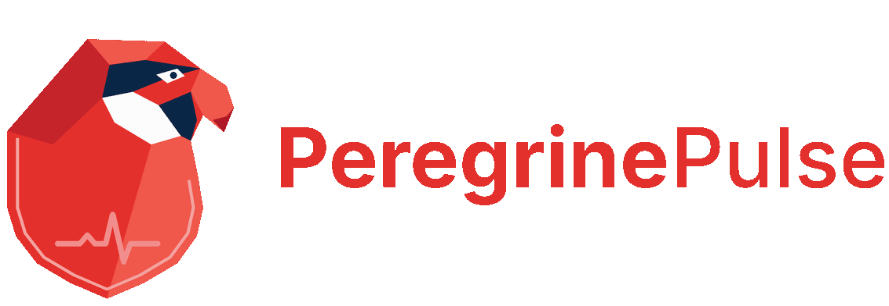
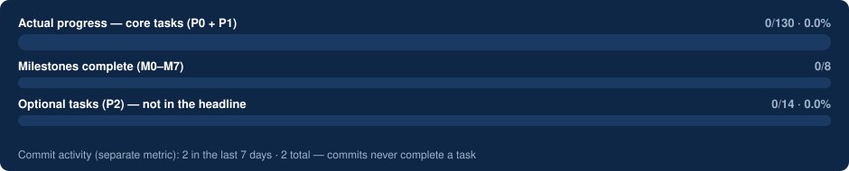
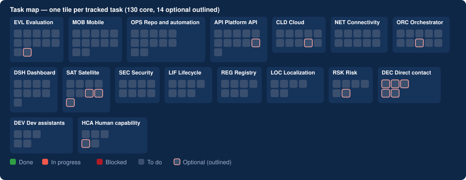
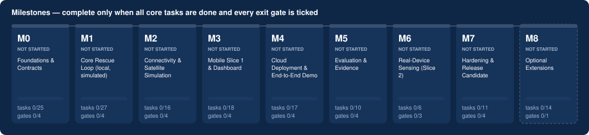

  

<b>Autonomous Human-Centered Rescue Intelligence</b>

  Team <b>FalcoPeregrinus</b> · Android app · Cloud platform · Responder dashboard

> **Prototype.** PeregrinePulse is a simulated rescue-coordination system. It is **not** a certified emergency dispatch system, it makes no claim of integration with official emergency services, and everything simulated is labelled *SIMULATED*. The repository is at the **planning and skeleton stage**: no feature is complete until it is implemented, tested and documented.

---

## Project Overview

PeregrinePulse coordinates emergency assistance from the first danger signal until a **trusted acknowledgment** is received. It runs a closed loop — **Observe → Interpret → Assess → Plan → Act → Verify → Adapt** — and, unlike a one-button SOS, it weighs risk and confidence, the person's ability to communicate, the assistance needed, how capable and safe each entity is, and the state of every communication path. It never treats "sent" as "handled".

**Works when connectivity does not.** The communication ladder falls back from Wi-Fi to the mobile network and then to a satellite path (a rented third-party service, simulated in the initial experiments), and an honest offline queue keeps the request until a path exists — without ever claiming a delivery that did not happen.

**Direct contact with designated entities (planned, optional).** As a precaution, PeregrinePulse first sends the emergency message to the contacts registered by the user. In addition, the rescue agent is designed to contact the competent, registered assistance entities directly when a problem is detected, reflecting our commitment to human-centered emergency response. This capability is currently unconfirmed: it depends on authorization from those entities and is demonstrated only against clearly labelled test endpoints.

## Project Vision

No one's chance of receiving help should depend on their ability to open a phone, speak, or understand technical steps in a frightening moment. The long-term vision is a rescue-coordination platform that keeps working without connectivity, adapts to the person, routes to verified entities, and reports only what it can prove.

## Target Users

| User | Need |
|---|---|
| People who cannot request help (injured, unresponsive, frightened, deaf or non-speaking, mobility-impaired) | A help request that does not depend on speech or fine motion |
| Children *(later, after specialist review)* | Simple, safe, non-burdensome interaction |
| Registered personal contacts | Timely, minimal, consented notification |
| Assistance entities | Structured, prioritised, verifiable alerts |
| Operators and judges | A clear view of state, reasons and evidence |

## Core Features

| Tier | Features |
|---|---|
| **MVP** | Simulated incident (provisional scenario: vehicle collision with an unresponsive driver) · multi-signal risk assessment with confidence · verification and cancel · capability estimate · test registry and entity selection with hard exclusion rules · simulated contact notification · evidence-based lifecycle with acknowledgment and escalation · connectivity ladder, offline queue and retry · tiered messages (Tier 1 first) · simulated satellite link and gateway · decision trace · responder dashboard · thin Android app · baseline comparison |
| **Essential** | Deployment on Huawei Cloud (ECS + RDS) · AI development assistants · authentication and role-based authorization · real sensor capture on listed devices · documented synthetic dataset |
| **Secondary** | ESP32 satellite-module emulator · direct entity contact *(unconfirmed)* · optional cache · child-safe and accessibility extensions after review |
| **Future** | Real satellite provider and module · nearby relay · iOS and HarmonyOS NEXT · learned detection models · sign-language interfaces · field pilots with real entities |

## Project Scope

**In scope:** Android app, cloud platform and web dashboard; one locked MVP scenario; simulated incidents and clearly labelled test entities; Wi-Fi → mobile network → satellite ladder with offline queue; evidence-backed lifecycle and escalation; reproducible experiments against a static-SOS baseline; interface languages English, Arabic and Chinese.

**Out of scope:** SIM/eSIM, wallet, advertising or pricing · claims of official emergency integration · replacing the national emergency number · medical diagnosis, medication or dosage advice · always-on camera or microphone · building or operating our own satellite or ground station.

## Goals

| ID | Goal |
|---|---|
| G1 | Reduce time to the first useful information reaching an entity, versus a static SOS baseline |
| G2 | Increase the share of requests that receive a trusted human acknowledgment |
| G3 | Measure recovery time after the first selected entity fails to acknowledge |
| G4 | Deliver Tier-1 critical information under weak and absent connectivity (satellite path simulated) |
| G5 | **Offline honesty:** never show "Delivered" or "Acknowledged" without evidence |
| G6 | Measure adaptation to the person's ability to respond |
| G7 | Measure detection quality: precision, recall, false-positive and false-negative rates |
| G8 | Run the system deployed on Huawei Cloud (ECS + RDS) |
| G9 | Make every experiment reproducible: fixed seed, fixed configuration, one command |
| G10 | *(Optional, unconfirmed)* Enable the rescue agent to reach designated assistance entities directly when a problem is detected, subject to authorization |

No numeric targets are stated until the baseline has been measured.

## Tech Stack

| Area | Technology | State |
|---|---|---|
| Mobile | Android native (Kotlin), thin app with a platform-independent `:core` module; FCM and HMS behind an abstraction | Planned |
| Backend | Python, FastAPI | Skeleton |
| Decision engine | Deterministic rules and state machine; optional model proposals behind a policy gate | Contracts drafted |
| Dashboard | React (Vite) | Skeleton |
| Database | Huawei Cloud RDS for MySQL (source of truth) | Planned |
| Hosting | Huawei Cloud ECS | Planned |
| Cache | Huawei Cloud DCS for Redis | Optional |
| Satellite path | Rented third-party service (provider TBD), simulated at first | Planned |
| Satellite-module emulator | ESP32 over BLE/USB | Optional |
| Contracts | JSON Schema | Drafted |
| Testing | pytest, JUnit (mobile core), component tests (dashboard) | Partly in place |
| Automation | GitHub Actions, Python tracking scripts | Generated |
| UI languages | English, Arabic, Chinese | Planned |

## Project Progress

Actual progress is computed from the task statuses in [`PROJECT_PLAN.md`](PROJECT_PLAN.md). Commit activity is shown separately and never counts as progress. This section is refreshed automatically after every successful push to `main` in the upstream repository.

<!-- PROGRESS:START -->

**Actual progress:** 0 of 130 core tasks done (0.0%). Optional tasks: 0 of 14.

**Commit activity** (separate metric): 2 commits in the last 7 days, 2 in total. A commit never completes a task.

Progress by concept

| Concept | Done | Total | Core done |
|---|---:|---:|---:|
| LIF · Incident Lifecycle & Contracts | 0 | 7 | 0% |
| RSK · Detection & Risk Assessment | 0 | 6 | 0% |
| HCA · Human Capability & Interaction | 0 | 5 | 0% |
| REG · Registry & Contacts | 0 | 7 | 0% |
| ORC · Rescue Orchestrator | 0 | 10 | 0% |
| NET · Connectivity Ladder & Offline Delivery | 0 | 10 | 0% |
| SAT · Satellite Path | 0 | 9 | 0% |
| MOB · Mobile App | 0 | 12 | 0% |
| API · Platform API & Data | 0 | 11 | 0% |
| DSH · Responder Dashboard | 0 | 9 | 0% |
| CLD · Cloud Deployment | 0 | 10 | 0% |
| DEV · AI Development Assistants | 0 | 5 | 0% |
| SEC · Security, Privacy & Safety | 0 | 8 | 0% |
| EVL · Evaluation & Experiments | 0 | 12 | 0% |
| OPS · Repository, Automation & Docs | 0 | 12 | 0% |
| LOC · Localization & Accessibility | 0 | 6 | 0% |
| DEC · Direct Entity Contact *(optional, unconfirmed)* | 0 | 5 | 0% |

<!-- PROGRESS:END -->

## Milestones

Milestone status is computed from the associated tasks and exit gates in [`PROJECT_PLAN.md`](PROJECT_PLAN.md).

<!-- MILESTONES:START -->

A milestone is complete only when all of its core tasks are done **and** every exit gate is ticked.

| Milestone | Name | Status | Tasks | Gates |
|---|---|---|---:|---:|
| M0 | Foundations & Contracts | not started | 0/25 | 0/4 |
| M1 | Core Rescue Loop (local, simulated) | not started | 0/27 | 0/4 |
| M2 | Connectivity & Satellite Simulation | not started | 0/16 | 0/4 |
| M3 | Mobile Slice 1 & Dashboard | not started | 0/18 | 0/4 |
| M4 | Cloud Deployment & End-to-End Demo | not started | 0/17 | 0/4 |
| M5 | Evaluation & Evidence | not started | 0/10 | 0/4 |
| M6 | Real-Device Sensing (Slice 2) | not started | 0/6 | 0/3 |
| M7 | Hardening & Release Candidate | not started | 0/11 | 0/4 |
| M8 | Optional Extensions | not started (optional) | 0/14 | 0/1 |
<!-- MILESTONES:END -->

## Definition of Done

A **task** is done when it is implemented as specified, its tests pass, it has been reviewed by another team member, documentation (and contracts or ADRs, if affected) is updated, no secrets or personal data were added, and its status is set to `done` in `PROJECT_PLAN.md` in the same pull request. A **milestone** is complete when every core task assigned to it is done, every exit gate is ticked with evidence, and its flow has been run end to end. Simulated results are never reported as field results.

## Risks & Assumptions

**Key risks:** Android background-sensing limits · no Huawei test device yet · satellite provider availability, cost and regulation in Egypt · simulation mistaken for field results · false alarms and missed events · overclaiming delivery or acknowledgment · cloud services, region and credits · medical or child content without specialist review · sensitive data in a public repository · scope creep.

**Assumptions:** prototype only, with simulated incidents and test entities · satellite connectivity is rented and simulated first, and simulation parameters are assumptions, not measurements · backend, dashboard and database follow the technical specification and are still *proposed* · the MVP scenario is provisional · optional work is tracked but excluded from the headline progress · repository protection is deferred to a separate phase.

The full register is in [`PROJECT_PLAN.md`](PROJECT_PLAN.md).

## Documentation

[`PROJECT_PLAN.md`](PROJECT_PLAN.md) (execution plan) · [`setup.md`](setup.md) (development setup) · [`docs/`](docs/) (architecture, ADRs, contributing, automation) · [`contracts/`](contracts/) (shared schemas)

## License

All rights reserved. Source is viewable for evaluation only; see [`LICENSE`](LICENSE).
